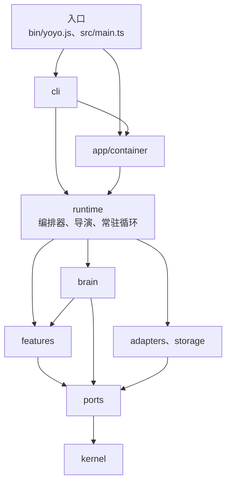
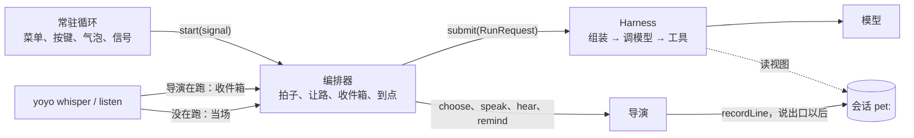
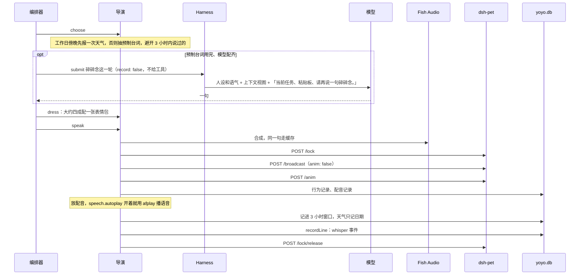
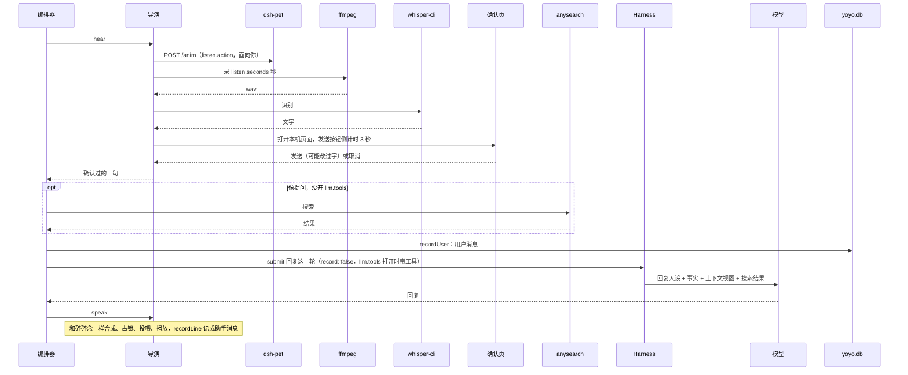
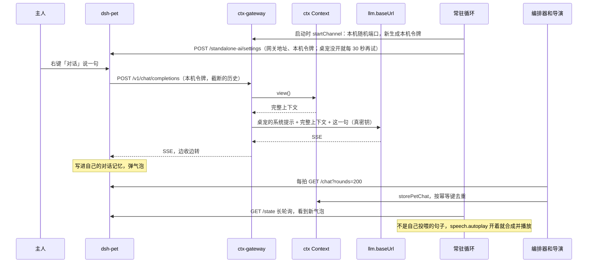

# 分层

依赖只朝一个方向：`kernel` ← `ports` ← `features` / `brain` / `adapters` ← `runtime` ← `cli` / `app/container` ← 入口。箭头指向被依赖的一层。



* `features` 和 `brain` 只依赖端口接口，不依赖 `adapters`。`brain` 可以用 `features` 里的纯逻辑，例如粘贴板最近一条、加日程、查天气。
* `adapters` 和 `storage` 不依赖 `features`、`brain`、`runtime`。
* `app/config.ts`、`app/paths.ts`、`app/log.ts` 是共享的叶子模块，只依赖 zod、Node 和端口类型，哪一层都可以引用。`app/container.ts` 是组装根，在最上层。
* `cli` 和组装根可以直接用下面任何一层。
* `packages/dsh-pet` 不依赖 yoyo 的任何东西。

`features`、`brain`、编排器、导演和常驻循环只认端口。换平台、换服务商、写测试替身，都只需要另给一份实现，在组装根里挑。按键助手也由组装根给：常驻循环只调 `startHotkey()`，只有 macOS 且 `hotkey.enabled` 时才真的起。[^ports] [^container]

# 目录

| 目录 | 内容 |
| --- | --- |
| `src/kernel` | 领域类型（`types.ts`）和纯函数：语气、时间、碎碎念让路、气泡时长和记录类型。不做 IO |
| `src/ports` | 外部能力的接口：`PetHost`（舞台加对话记忆、工作状态、菜单、气泡、对话渠道）、`Synthesizer`、`AudioPlayer`、`Recorder`、`Transcriber`、`SfxPlayer`、`Clipboard`、`UrlOpener`、`WebSearch`、`Repos`、`Logger` |
| `src/app/config.ts`、`paths.ts`、`log.ts`、`warnings.ts` | 配置结构（zod，缺省值都在这里，和旧版一样宽松：写错按缺省值）、所有读写位置（`YOYO_HOME`、`YOYO_CONFIG` 可换）、日志、只去掉 node:sqlite 那条 ExperimentalWarning 的过滤 |
| `src/features` | 一个功能一个目录：`whisper`（预制台词和 3 小时窗口）、`weather`、`alarms`、`memes`、`contacts`、`clipboard`、`listen`（听写规则和确认页）、`search`（像不像提问） |
| `src/brain` | ctx 接线：`context.ts`（会话、投影、旧库迁移、写入）、`sources.ts`、`prompts.ts`、`agents.ts`（碎碎念和回复两个 agent 配置）、`compose.ts`（拼一轮的请求、经编排器跑、解析成台词）、`harness.ts`（跑一轮的 harness）、`model.ts`、`tools.ts`、`mcp.ts`、`channel.ts` |
| `src/adapters` | 端口的实现：`dsh-pet`、`console`、`voice`（Fish Audio、afplay、ffmpeg、whisper.cpp、配音；没配语音、不是 macOS 时用 `silent.ts` 的静音实现）、`platform`（pbpaste、open、按键助手，别的系统用 `noop`）、`search`（anysearch） |
| `src/storage` | `~/.yoyo/yoyo.db`：建表、旧 JSON 的一次性导入、`Repos` 的实现 |
| `src/runtime` | `orchestrator.ts`（编排器：实现 ctx 的 `Orchestrator`，加上拍子、让路、收件箱、到点，碎碎念和听一句两段流程）、`director.ts`（导演：说、听、提醒、预合成、压缩这些舞台动作）、`daemon.ts`（常驻进程：渠道、菜单、按键、气泡、信号）、`inbox.ts`（收件箱和 pid）、`compact.ts`、`testing.ts`（测试替身） |
| `src/cli` | `registry.ts`（参数解析、分层输出、`find`、`inspect`）、`commands.ts`（领域表）、`main.ts` |
| `src/app/container.ts` | 组装根：按配置挑实现，建模型、工具和 MCP，建上下文、harness、导演和编排器，开对话渠道 |
| `src/main.ts`、`bin/yoyo.js`、`src/main.js` | 常驻进程入口、命令行入口；`src/main.js` 只转到 `main.ts`，旧的 `node src/main.js` 照旧能启动。两个入口第一条都引入 `app/warnings.ts` |
| `packages/dsh-pet` | `@yoyo/dsh-pet`：dsh-pet 独立模式 HTTP 接口的类型化客户端，只照 `openapi.yaml` 写 |

# 常驻进程

`src/main.ts` 读配置、检查驱动桌宠时语音配好了（控制台舞台不查）、写 pid，再交给 `createApp` 组装：打开 `yoyo.db`（顺带导入旧 JSON），按 `stage` 挑宿主，建语音（Fish 的四项没填齐就用不出声的合成器，只出字）、播放和配音（只有 macOS 用 afplay，别处不播放）、录音、识别、搜索，模型配齐了才建模型，`llm.tools` 打开才建工具并连 MCP（写错的服务器跳过），最后建上下文、harness、导演和编排器。[^container]

四样东西各管一件事：

| 谁 | 管什么 | 代码 |
| --- | --- | --- |
| 编排器 | 什么时候、在哪个会话上跑一轮：每秒一拍，到点、让路、收件箱、定时压缩；碎碎念和听一句这两段流程里，决定要不要跑模型，把这一轮 `submit` 给 harness。实现 ctx 的 `Orchestrator` | `createYoyoOrchestrator` |
| Harness | 跑一轮：组装上下文、调模型、把工具调用交给执行环境。`record: false`，不写日志 | `createYoyoHarness` |
| 导演 | 舞台上的动作：挑天气或预制台词、配表情包、合成、占锁投喂、播放、`recordLine`；侧耳听、确认；提醒；预合成；压缩 | `createDirector` |
| 常驻循环 | 进程：接对话渠道、挂右键菜单和按键、盯气泡、收信号；拍子交给编排器 | `runDaemon` |



`runDaemon` 在后台接对话渠道（网关只开一次；桌宠还没开、接不上就每 30 秒再接，只记第一次失败），挂右键菜单、调组装根给的 `startHotkey()`、盯气泡变化，然后 `orchestrator.start(signal)`。[^daemon] 编排器每秒一拍，上一拍没走完就跳过：[^orchestrator]

1. 粘贴板有变化就记一条（`clipboard.enabled`）。
2. 导演并进桌宠的对话记忆。
3. 取走收件箱里的请求：命令、菜单和按键交来的「听一句」「碎碎念」。
4. 到点的闹钟和任务，由导演提醒。
5. 离下一句日常碎碎念还有 20 秒以上，就让导演去找表情包：空套餐隔 1 小时、有图的隔 6 小时才重新搜，失败了隔 10 分钟再找。
6. 到点了就说一句；30 秒内有过对话就先顺延，没说成隔一分钟再试。
7. 配了 `context.compactAt` 时，每 10 分钟最多让导演看一次要不要压缩；压一次最多等 60 秒，超时这次就不压。

停下时（SIGINT、SIGTERM）先停拍子，正在跑的模型一起取消，再关应用：编排器不再收新的一轮、等手上的结束，然后关 MCP 和对话渠道。`--once` 由编排器说一句，`--bake` 由导演预合成，做完就关。

# 和 ctx 组件的对应

ctx 把一个 agent 拆成七个组件，每个一个协议，见 [ctx 仓库](https://github.com/modelctx-ai/ctx)的 `docs/concepts.md`。yoyo 里各是什么：[^orchestrator] [^harness] [^agents]

| ctx 组件 | yoyo 里是什么 | 代码 |
| --- | --- | --- |
| 会话 `SessionStore` | `~/.yoyo/yoyo.db` 里的 `ctx_entries`（ctx-sqlite），每只宠物一个会话 `pet:<id>` | `createYoyoContext`、`sessionFor` |
| 上下文 `ContextBuilder` | ctx 的参考实现，配 `yoyoProjection`（碎碎念事件折成一条助手消息）和两个来源（工作状态、粘贴板）。事实怎么收、放哪由每个 agent 的 `context` 定，builder 照做 | `yoyoProjection`、`taskSource`、`clipboardSource` |
| 工具 `ToolRegistry` | `llm.tools` 打开才有：`web_search`、`weather_forecast`、`list_alarms`、`add_alarm`，加 `mcpServers` 的工具 | `createYoyoTools`、`connectMcp` |
| 执行环境 `Executor` | 注册表自带的进程内函数执行环境；每台 MCP 服务器经 ctx-mcp 的 hub | `createYoyoHarness` 的 `executors` |
| `Harness` | ctx 的参考实现（AI SDK 循环）。碎碎念和回复是同一个 harness 跑的两个 `AgentSpec` | `createYoyoHarness`、`agents.ts` |
| 编排 `Orchestrator` | yoyo 的编排器：协议的几样交给 ctx 的进程内队列（同一会话串行），加上拍子、让路、收件箱、到点 | `createYoyoOrchestrator` |
| 模型 | ctx-models 按 `llm` 配置造的 AI SDK 模型，进程内对象放在 `AgentSpec.model` 里 | `createLanguageModel` |

# 怎么用 ctx

三个仓库怎么分工、契约是什么，见 [ctx 仓库](https://github.com/modelctx-ai/ctx)的 `docs/repos.md`；ctx 自己的概念（会话、条目、投影、来源、记录、压缩、执行环境、harness、编排、网关）见同一处的 `docs/concepts.md` 和 `docs/architecture.md`。这里只写 yoyo 的用法。[^context] [^compose]

| 方面 | 做法 | 代码 |
| --- | --- | --- |
| 存储 | `createSqliteStore({ database, prefix: 'ctx_' })` 复用已经打开的 `yoyo.db`，表是 `ctx_entries`、`ctx_meta` | `createYoyoContext` |
| 会话 | 每只宠物一个：`pet:<pet.id>` | `sessionFor` |
| 投影 | `whisper` 事件 `fold`：连续的碎碎念渲染成一条助手消息「碎碎念：\n…」；摘要渲染成「前面对话的摘要：\n…」；用户话和回复原样带上，不截断。配了 `context.maxTokens` 才按估算 token 裁剪 | `yoyoProjection` |
| 写入 | 回复、提醒、天气记成助手消息；碎碎念（预制的和模型写的）记成 `whisper` 事件；听到的话记成用户消息。经这个上下文写的条目 `source` 是 `yoyo` | `recordLine`、`recordUser` |
| 来源 | `task`：桌宠的工作状态加本地任务的前 5 条；`clipboard`：最近一次复制的前 160 字，`clipboard.enabled` 关掉时不挂 | `taskSource`、`clipboardSource` |
| agent | 碎碎念和回复各是一个 `AgentSpec`，放在 `agents.ts`：名字、工具、步数、参数（`temperature`、30 秒超时、重试一次）和 `context`（事实放哪）是 JSON；人设加语气、模型每一轮填进去 | `WHISPER_AGENT`、`REPLY_AGENT` |
| 一轮 | `compose.ts` 拼成 `RunRequest`（`session`、`agent`、`prompt`、`record: false`、`signal`），交给编排器 `submit`，等 `done`；这一刻的事实由 harness 里的 builder 按 agent 的 `context` 收 | `whisperRequest`、`replyRequest` |
| 碎碎念 | 指令是人设加语气；历史是上下文视图；事实放进最后一条临时用户消息（`context.facts.placement` 是 `prompt`），空一行，末尾「请再说一句碎碎念。」。`temperature` 0.8，不给工具。和视图里已有的句子重复就报错，这一次不说 | `generateWhisper` |
| 回复 | 指令是回复人设加语气，事实追加在指令后（`placement` 是 `instructions`）；有搜索结果时最后加一条「搜索结果：\n…」。`temperature` 0.7；`llm.tools` 打开时给工具，最多 4 步 | `generateReply` |
| 事实 | 两个 agent 放的位置不一样，写在各自的 `AgentSpec.context.facts` 里：碎碎念 `placement: 'prompt'`，回复 `placement: 'instructions'`。来源和投影用缺省（全部来源、`default` 投影）。harness 直接用上下文的 builder，不再包一层 | `WHISPER_AGENT`、`REPLY_AGENT`、`createYoyoHarness` |
| 记录 | 每一轮都是 `record: false`：用户这句、回复和 `ctx.run.*` 都不写。听到的话在跑回复之前由编排器 `recordUser`；合成、投喂、播放成功以后，导演才 `recordLine`；没说出口的句子不进上下文 | `orchestrator.ts`、`director.ts` |
| 报错 | `stopReason` 是 `error` 或 `aborted` 就报错。`RunResult.error`（`ErrorInfo`）带 `statusCode` 和 `responseBody`，`compose.ts` 抹掉 `llm.apiKey`、压成一行、截到 180 字，和 `describeError` 对抛出来的错误做的一样；有状态码时「模型接口返回 <状态码>：<正文片段>」，否则「模型没回：…」 | `compose.ts` |
| 桌宠对话 | 每拍读 `GET /chat?rounds=200`，按幂等键 `pet:<ts>:<role>:<text>` 并进来，`source` 是 `dsh-pet`；已有的键由存储跳过。导入的条目 `at` 是过去，日志里排在写入的位置，投影和 `yoyo context tail` 按 `(at, seq)` 排回原来的位置（`compareEntries`） | `storePetChat` |
| 网关 | 右键对话走 `startGateway({ upstream, accessToken, rewrite: withContext(context) })`，本机随机端口；`channel-base`、`channel-token` 记进 kv，`yoyo chat sync` 用它重接。桌宠还没开时只重试 `bindChat`，每 30 秒一次。只支持 `openai-compatible` | `startChannel`、`connectChannel` |
| 工具 | `llm.tools` 打开才建注册表：`web_search`（配了 anysearch 才有）、`weather_forecast`、`list_alarms`、`add_alarm`，本地工具用 `addTool` 加；再加 `mcpServers` 的工具，MCP hub 本身是执行环境，经 `executors` 交给上下文和 harness | `createYoyoTools`、`connectMcp` |
| 压缩 | 配了 `context.compactAt` 才自动压：整段历史超过阈值就 `compact({ keep: context.keep, timeoutMs: 60_000 })`，摘要之前的条目还在库里。压缩另记的 `ctx.compacted` 和别的框架事件 `ctx.*` 投影里看不见，不计入阈值，`yoyo context tail` 也不列。`yoyo context compact` 随时手动压，超时一样 | `compactIfNeeded`、`compactContext` |
| 旧摘要 | 摘要的 `covers` 在 ctx 0.3 里按 `seq` 算，升级前写的旧摘要（`v` 是 0）可能盖住了后写进来的旧记录。常驻进程启动时、开拍子之前找一次：有，而且有模型，就用 `COMPACT_INSTRUCTIONS` 重新压一次，新摘要取代旧摘要；没有模型记一条警告，下次启动再做。命令行不做，出错不挡启动 | `recompactLossySummaries`、`runDaemon` |
| 模型 | `createModel({ provider, baseUrl, apiKey, model })`；没配齐就是 `null`：只用预制台词，碎碎念说完也不听 | `createLanguageModel` |
| 迁移 | `createSqliteStore` 打开库时自己升级结构：ctx 0.1 的 `ctx_entries.thread` 列在写锁里改名成 `session`，`ctx_meta` 的 schema 升到 `2`；yoyo 之前自己改过名的库（列已是 `session`，schema 仍是 `1`）只升版本；ctx 0.3 再升到 `3`：加行格式版本 `v` 和生成列 `kind`，索引 `(session, at, seq)` 换成 `(session, seq)`，旧行不改写、读时升级。失败回滚，下次再试。然后 yoyo 把旧表 `context_items` 迁进会话，改名成 `context_items_migrated`，在一个事务里，失败回滚，下次再试 | `migrateLegacyContext` |

# 怎么用 dsh-pet

只经 `@yoyo/dsh-pet` 调官方 HTTP 接口，契约是 dsh-pet 仓库的 `openapi.yaml`。不改宠物仓库，也不读它的文件，只读独立模式的运行状态文件取令牌。[^client]

| 接口 | 用途 | `PetHost` |
| --- | --- | --- |
| `GET /state` | 工作状态（`sections.workStatus`）；带 `?since=&timeout=` 长轮询，看气泡（`pets.<id>.say`）有没有新句子 | `workStatus`、`sayings` |
| `GET /chat?pet=&rounds=200` | 桌宠的对话记忆 | `chatHistory` |
| `POST /lock` | 占住这只宠物 | `present` |
| `POST /broadcast` | 投喂台词：`text`、`duration`、表情包 `url`，`anim: false` | `present` |
| `POST /anim` | 点播动作；开始听时也用，不占锁 | `present`、`cue` |
| `POST /lock/release` | 放开，失败不抛错 | `present` |
| `POST /menu/item` | 注册右键 yoyo 分组：「碎碎念」「听一句」，只在桌面端 | `menu` |
| `GET /menu/events?owner=yoyo&wait=` | 长轮询菜单点击；回 `unknown-owner` 就重新注册 | `menu` |
| `POST /standalone-ai/settings` | 右键对话改走 yoyo 的网关，`automaticWhispers: false`。独立模式自己的设置接口，挂在服务根上，不在 `openapi.yaml` 里 | `bindChat` |

* 每次请求都重新读 `~/.dsh/dsh-pet/standalone-runtime.json`（`YOYO_PET_RUNTIME` 可换）里的令牌，带在 `x-dsh-pet-token` 里。桌宠重启换了令牌也不用重启 yoyo。
* `/lock`、`/broadcast`、`/anim` 带 `?pet=&surface=`，持锁时加 `lock=`。`/lock/release` 和 `GET /chat` 只带 `pet`，宠物中途被隐藏也撤得掉锁。
* 业务失败是 HTTP 200 加 `ok: false`，按 `message`、`reason` 抛 `PetApiError`。单次请求 15 秒超时，长轮询在等待时长之外再给 12 秒。
* 不调用 `POST /whisper` 和 `POST /chat`。独立模式下这两条回 `provider-missing`。

# 数据流

## 说一句碎碎念

编排器到点、右键「碎碎念」、`yoyo whisper` 都走编排器的 `whisper()`：编排器决定要不要跑模型，导演表演，说出口以后才记。[^orchestrator] [^director]



模型配齐、`listen.enabled` 打开时，碎碎念说完编排器接着让导演听一句，见下一节。天气和提醒不听。

## 听一句、确认、回复

碎碎念说完、右键「听一句」、`yoyo listen`、Control+Option+Y 都走这一段（后三个是编排器的 `listen()`）。[^orchestrator] [^director]



没听清（不到 2 个字）就不回复；取消也不回复，只记一笔 `confirm-cancel`。

## 右键对话

右键「对话」仍是桌宠自己的输入框，yoyo 只换掉它的模型地址和历史。这一路不经过 harness 和编排器：网关只读上下文视图，原样转发。[^channel] [^daemon]



网关只读上下文，不写。问答是下一拍从桌宠的对话记忆并进来的。

# 扩展

## 加一条命令

在 `src/cli/commands.ts` 的 `buildDomains(env)` 里加一个领域，或给已有领域加一个动作。`find`、`inspect` 读同一张表，不用另写帮助。原则见[命令原则](cli-principles.md)。

```ts
{
  name: 'task',
  summary: '本地任务',
  detail: '碎碎念和回复会带上前 5 条。',
  verbs: [
    {
      name: 'list',
      summary: '列出本地任务',
      run() {
        const items = env.repos().tasks.list();
        if (items.length === 0) return env.out('还没有任务');
        for (const item of items) env.out(item);
      },
    },
  ],
},
```

* 参数写进 `flags`，在 `run(flags)` 里用 `flagText(flags, 'name')` 读。
* 要用的东西都从 `env` 按需拿：`env.repos()`、`env.config()`、`env.host()`、`env.app()`。只读写本地库的命令不读配置，也不碰桌宠和语音。
* 要说话或听的命令，导演在跑时用 `enqueue` 交给它的编排器（`handoff`），没在跑才 `env.app()` 组装一份、由 `app.orchestrator` 当场做，用完 `close()`。
* 测试用 `createCommandEnv(paths, { out, overrides })`，见 `commands.test.ts`。

## 加一个功能

1. 纯逻辑放进 `src/features/<名字>/`，只依赖 `kernel`、`ports` 和 `app/config.ts` 的类型。时间、随机数、网络从参数传进来，测试放在旁边的 `*.test.ts`，不联网。
2. 要存东西：表加在 `src/storage/db.ts` 的 `SCHEMA`（`CREATE TABLE IF NOT EXISTS`，老库启动时补上），接口加进 `src/ports/index.ts` 的 `Repos`，实现写在 `src/storage/repos.ts`。
3. 要用外部能力：先在 `ports` 定接口，实现放进 `adapters`，见下一节。
4. 要开口：舞台上的动作加在导演里，内部走 `speak`，先合成、再占锁投喂、播放、记行为和上下文。什么时候做由编排器定：定时做的事放进编排器的一拍（`tick`）。
5. 要跑模型：在 `src/brain/agents.ts` 加一个 agent 配置，在 `compose.ts` 拼这一轮的 `RunRequest`（`record: false`），经编排器 `submit`。说出口以后再由导演记。
6. 新的配置项加进 `src/app/config.ts`，用文件里的 `text`、`flag`、`count` 这类写法：给缺省值，写错也按缺省值，老的 `config.json` 不受影响。
7. 做过的事记一条行为：`repos.activity.record({ type: '…' })`，不写密钥。

## 给端口加一个实现

以另一家语音合成为例：

1. 在 `src/adapters/voice/` 写一个工厂，返回 `Synthesizer`：`synthesize(text, cue)` 返回音频文件路径，同一句（含情绪标签）走缓存。缓存放自己的目录，或者用不同的键，别覆盖 `~/.yoyo/speech-cache` 里 Fish 的 mp3。
2. 在 `src/app/config.ts` 的 `speech` 里加选项（例如服务商名），给缺省值。`speechReady` 和 `assertDirectorReady`（驱动桌宠时）现在要求 Fish 的四项都填，一起改。
3. 在 `src/app/container.ts` 里按配置挑实现。编排器、导演和命令只认端口，不用改。
4. 测试里网络和子进程从参数注入，照 `fish.test.ts` 写。

换舞台也一样：实现 `PetHost`（`src/adapters/console/host.ts` 是最小的例子），在 `createPetHost` 里按 `stage` 挑，再给 `stage` 的枚举加一项。对话渠道只在宿主是 `dsh-pet` 时才接。

## 加一个模型工具

在 `src/brain/tools.ts` 的 `createYoyoTools()` 里注册：

```ts
registry.addTool(
  'list_contacts',
  tool({
    description: '列出主人存过的 yoyo 联系人：名字和地址。',
    inputSchema: z.object({}),
    execute: async () => repos.contacts.list(),
  }),
);
```

* 名字只用字母、数字、`_`、`-`，最长 64。
* 照现有工具的写法，出错返回一句中文，不抛错，模型能接着说。
* 改了库的工具要记行为，例如 `add_alarm` 经 `addSchedule` 记 `schedule-add`。
* 只有 `llm.tools` 打开时才交给模型，而且只在回复时给；碎碎念的 agent 配置是 `tools: false`。

## 接一个 MCP 服务器

只改 `config.json`，不改代码：

```json
{
  "llm": { "tools": true },
  "mcpServers": {
    "notes": { "command": "node", "args": ["/path/to/notes-server.js"], "include": ["search_notes"] },
    "docs": { "url": "https://mcp.example.com/mcp", "headers": { "authorization": "Bearer <token>" } }
  }
}
```

* 有 `command` 走 stdio（`args`、`env`、`cwd`），有 `url` 走 Streamable HTTP，`"type": "sse"` 走 SSE。
* `include`、`exclude` 用服务器上的原名挑工具，`"enabled": false` 先不连。
* 工具名加服务器前缀，例如 `notes__search_notes`。
* 启动时连接，连不上只记一行「MCP notes 没连上：…」，其余照常；退出时关掉。
* 每台服务器连接前才检查：没有 `command` 也没有 `url` 就记一行「MCP notes 的配置不对，要有 command 或 url，先跳过」；`type` 只认 `http`、`sse`，别的按缺省；其余字段写错当没写。

## 不接桌宠跑

`"stage": "console"` 把台词打印成 `[动作] 文字`，不占锁，没有菜单、对话记忆和右键对话，工作状态是空的。语音可以不配：Fish 的四项没填齐就只出字。不在 macOS 上不播放声音、不做配音，按键助手也不起；`listen.enabled` 缺省是关的，听写要 macOS 的 ffmpeg。在任何机器上都能跑，用一个单独的数据目录和配置，就不会碰到平时的库：

```sh
YOYO_HOME=/tmp/yoyo-dev YOYO_CONFIG=/tmp/yoyo-dev/config.json pnpm once
```

测试里用 `createApp(config, paths, overrides)` 换掉任意一项服务；`src/runtime/testing.ts` 有内存里的替身（含只记调用的导演），不联网、不开子进程。编排器跑 ctx 的契约测试 `describeOrchestratorContract`，见 `orchestrator.test.ts`。

[^ports]: 端口
[^container]: 组装根
[^context]: 上下文接线
[^compose]: 一轮的请求
[^agents]: agent 配置
[^harness]: Harness
[^orchestrator]: 编排器
[^channel]: 对话渠道
[^director]: 导演
[^daemon]: 常驻循环
[^client]: dsh-pet 客户端
